# Microchip PolarFire® FPGA SLVS to CoaXPress Converter Design 

## Introduction

The demand for high-speed, high-resolution imaging continues to grow across industries such as machine vision, industrial automation and medical imaging. Robust, scalable and interoperable solutions for camera-to-host connectivity are essential. This document presents a technical demonstration that integrates two leading-edge interface standards:

- **Sony's Scalable Low-Voltage Signaling with Embedded Clock (SLVS-EC)** - Developed by Sony Semiconductor Solutions Corporation, enables high-speed, high-fidelity image sensor data transmission by integrating clock and data signals, thereby simplifying system design and improving signal integrity.

- **CoaXPress (CXP) Protocol** - A widely adopted standard for high-speed video, control and power transmission over coaxial cables. The latest version, v2.0, supports data rates of up to 12.5 Gbps per channel.

The demonstration leverages Microchip's PolarFire® FPGA platform, specifically the PolarFire® Quad Channel CXP-12 kit, together with an SLVS camera FMC device and a compatible frame grabber. This setup enables the capture of high-resolution and high-frame rate video from an SLVS-EC camera, enabling its real-time transmission over a 4-channel CoaXPress link, thus ensuring both high-bandwidth and low-latency.

The solution is implemented using Microchip's Libero® SoC Design Suite, providing a robust environment for hardware design, integration and customization.

This repository includes two separate reference designs, one supporting the IMX530 sensor and another supporting the IMX901 sensor.

### GenICam Integration

A key feature of this demonstration is the integration of **GenICam technology**, an industry-standard framework that abstracts camera features and provides a unified API for device configuration and control. By adhering to the GenICam standard, the solution ensures:

- Seamless interoperability with various software applications
- Simplified camera integration
- Feature discovery and management by frame grabbers
- Flexible and standardized access to camera parameters via GenICam-prescribed XML file

## Table of Contents

- [Introduction](#introduction)
- [Features of Camera Sensors](#features-of-camera-sensors)
- [Interoperability](#interoperability)
- [Design Architecture for IMX_530](#design-architecture-for-imx_530)
- [Design Architecture for IMX_901](#design-architecture-for-imx_901)
- [Demo Requirements](#demo-requirements)
- [Design Flow](#design-flow)
- [Demo Prerequisites](#demo-prerequisites)
- [Setting Up the Demo](#setting-up-the-demo)
  - [Frame Grabber Software Installation](#frame-grabber-software-installation)
  - [Setting up the Hardware](#setting-up-the-hardware)
- [Running the Demo](#running-the-demo)
- [Testing and Validation](#testing-and-validation)
- [Functional Description](#functional-description)
  - [Data Flow](#data-flow)
  - [Hardware Implementation](#hardware-implementation-for-imx_530)
  - [Transceiver Configuration](#transceiver-configuration-for-imx_530)
  - [Clocking Structure](#clocking-structure-for-imx_530)
  - [Reset Structure](#reset-structure)
- [Resource Utilization for IMX_530](#resource-utilization-for-imx_530)
- [Resource Utilization for IMX_901](#resource-utilization-for-imx_901)
- [Appendix A: Running the Tcl Script](#appendix-a-running-the-tcl-script)
- [Appendix B: Programming with FlashPro Express](#appendix-b-programming-with-flashpro-express)
- [Appendix C: Troubleshooting Guide](#appendix-c-troubleshooting-guide)
- [Reference Documents](#reference-documents)
- [Documentation and Support](#documentation-and-support)
- [Glossary](#glossary)

---
## Features of Camera Designs

### Features of IMX_530

  - 4 Lane CoaXPress device dynamically configurable from 1.5G to 12.5 Gbps speed
  - 8 Lane SLVS-EC camera at 2.376 Gbps
  - Streaming of video resolution **5312x4671 at 60 fps**
  - GenICam-enabled camera controls:
    - Analog Gain
    - Reverse X
    - Reverse Y
    - Test Pattern

### Features of IMX_901

  - 4 Lane CoaXPress device dynamically configurable from 1.5G to 12.5 Gbps speed
  - 4 Lane SLVS-EC 3.0 camera at 4.752 Gbps
  - Streaming of video resolution **7840x2112 at 60 fps**
  - GenICam-enabled camera controls:
    - Analog Gain
    - Reverse X
    - Reverse Y
    - Test Pattern

---

## Interoperability

CoaXPress device is tested for 4-channel connections with frame grabbers. The following table lists the tested frame grabbers and their software versions:

<b>Table 1: Supported Frame Grabbers and Software</b>

| Frame Grabber | Software |
|---------------|----------|
| Teledyne DALSA Xtium2-CXP PX8 CoaXPress Frame Grabber (OR-A8X0-XPX40) | Sapera-LT-SDK-8.73, Xtium2-CXP_PX8_1.10.01.0113 drivers |
| Euresys Coaxlink Quad CXP-12 Four connection CoaXPress Frame Grabber | eGrabber |
| HIKROBOT MV-GY1004 Quad CXP-12 Frame Grabber V2.0 | MVS |
| FireBird CoaXPress Frame Grabber (4xCXP12-3PE8) | ActiveCapture |
| BOPIXEL Frame Grabber (BO-CXP12X4) | bopixel |
| Hefei I-TEK Vulcan-CXP12 Frame Grabber | IKapLibrary |

---

## Design Architecture for IMX_530

The following block diagram illustrates the high-level architecture of the demo design, which bridges 8 lane SLVS-EC camera interface to a 4 channel CoaXPress frame grabber using PolarFire FPGA.

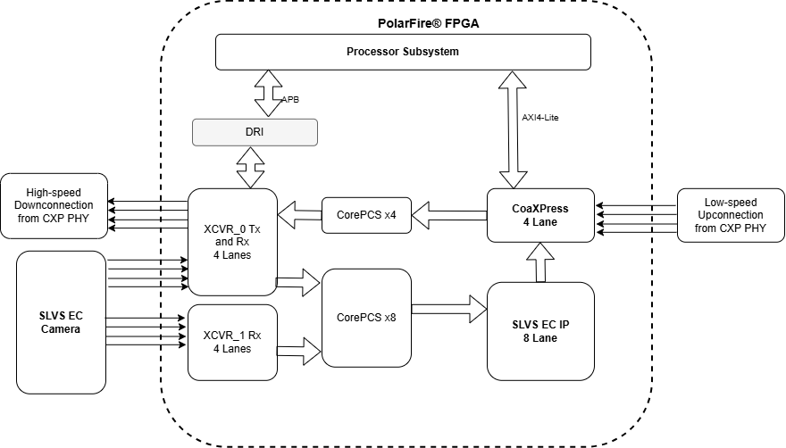

<b>Figure 1: Block Diagram of IMX_530</b>

## Design Architecture for IMX_901

The following block diagram illustrates the high-level architecture of the demo design, which bridges 4 lane SLVS-EC camera interface to a 4 channel CoaXPress frame grabber using PolarFire FPGA.

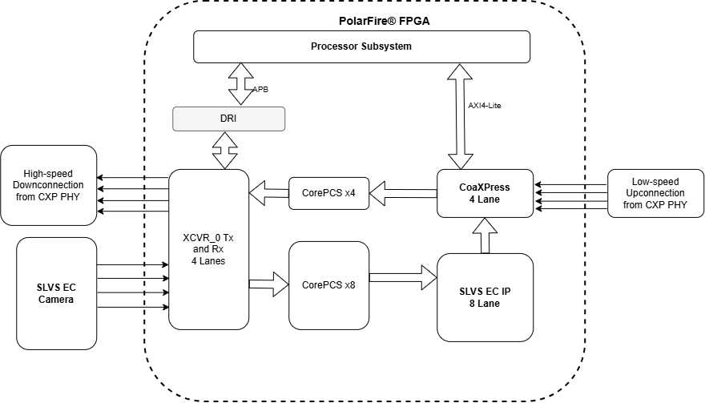

<b>Figure 2: Block Diagram of IMX_901</b>

---
## Demo Requirements

The following table lists the hardware and software requirements for running the demo:

<b>Table 2: Demo Requirements</b>

| Category | Requirement | Description |
|----------|-------------|-------------|
| Hardware | PolarFire Quad Channel CXP-12 kit | [MPF100-QCXP-KIT](https://www.microchip.com/en-us/development-tool/mpf100-qcxp-kit): PolarFire 4-Channel CoaXPress device board with MPF100T-1FCG484E device and USB type C cable |
| Hardware | SLVS-EC 2.0 FMC Camera | [VIDEO-DC-SLVS_IMX_530](https://www.microchip.com/en-us/development-tool/video-dc-slvs) |
| Hardware | SLVS-EC 3.0 FMC Camera | [VIDEO-DC-SLVS30_IMX_901](https://www.microchip.com/en-us/development-tool/VIDEO-DC-SLVS30) |
| Hardware | Frame Grabber | Four-connection CoaXPress CXP-12 frame grabber |
| Hardware | CoaXPress Cables | Four CXP-12 standard CoaXPress cables |
| Hardware | Host PC | PC that supports the frame grabber PCIe connection |
| Software | FlashPro Express | [FlashPro Express](https://www.microchip.com/en-us/products/fpgas-and-plds/fpga-and-soc-design-tools/programming-and-debug/lab) used to program the supplied job file. |
| Software | Libero® SoC Design Suite | [Libero® SoC Design Suite](https://www.microchip.com/en-us/products/fpgas-and-plds/fpga-and-soc-design-tools/fpga/libero-software-later-versions) used to open, modify, and rebuild the design. |
| Software | Frame Grabber Software | Appropriate software for your frame grabber (see [Interoperability](#interoperability) table) |

**Note**: Only one of SLVS-EC 2.0 FMC Camera or the SLVS-EC 3.0 FMC Camera is required.

## Design Flow

Follow the steps below to run the video capture demo.

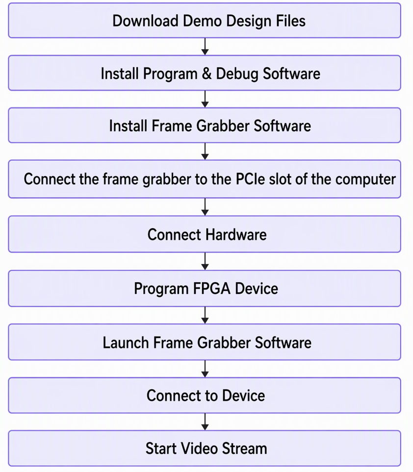

<b>Figure 3: Design Workflow</b>

---

## Demo Prerequisites

Before you start the demo, ensure that the following components are installed:

1. Download the packaged archive `mpf100-qcxp-kit-slvs-cxp-IMXxxx-vxxxx.x_Job.zip` for this release from the release assets of [this](https://github.com/microchip-fpga-solutions/mpf100-qcxp-kit-slvs-cxp/releases) repo. Note that there are different job files corresponding to different camera sensors. Extract it to obtain the programming .job file (`mpf100-qcxp-kit-slvs-cxp-IMXxxx.job`) used with FlashPro Express. See [Appendix B: Programming with FlashPro Express](#appendix-b-programming-with-flashpro-express).
2. Note that there are different Design folders `IMXxxx` corresponding to different camera sensors within this repository . To rebuild the design from source, use the Tcl scripts provided in the `/hw` folder in each design. See [Appendix A: Running the Tcl Script](#appendix-a-running-the-tcl-script).
3. Download and install FlashPro Express to program the device from the [Lab Programming and Debug Tools](https://www.microchip.com/en-us/products/fpgas-and-plds/fpga-and-soc-design-tools/programming-and-debug) webpage.
4. Download and install the Libero® SoC Design Suite from [Libero SoC Software Downloads](https://www.microchip.com/en-us/products/fpgas-and-plds/fpga-and-soc-design-tools/fpga/libero-software-later-versions).

> **Important:** The Libero SoC version and complete IP-core version list validated for each release are documented in the release notes on the [GitHub Releases](https://github.com/microchip-fpga-solutions/mpf100-qcxp-kit-slvs-cxp/releases) page.

---

## Setting Up the Demo

Setting up the demo involves the following steps:
- Frame Grabber Software Installation
- Setting up the Hardware
- Programming the FPGA Device - see [Appendix B: Programming with FlashPro Express](#appendix-b-programming-with-flashpro-express)

### Frame Grabber Software Installation

To install the frame grabber software, perform the following steps:

1. **Install the frame grabber into the host PC:** Carefully insert the frame grabber card into an available PCIe slot on your host PC, ensuring it is securely seated.

2. **Connect power to the frame grabber:** Attach the power cord to the frame grabber. This step is essential to enable **Power over CoaXPress (PoCXP)** functionality allowing the frame grabber to supply power to connected CoaXPress devices through the cable.

3. **Install frame grabber software:** Download and install the latest frame grabber software and drivers provided by the manufacturer. This software is necessary for your system to recognize and communicate with the frame grabber hardware.

4. **Verify installation:** Once the hardware and software are installed, restart your PC if prompted. Open the frame grabber software to confirm that the device is detected and functioning properly.

### Setting up the Hardware

The following figure shows the PolarFire Quad Channel CXP-12 kit:

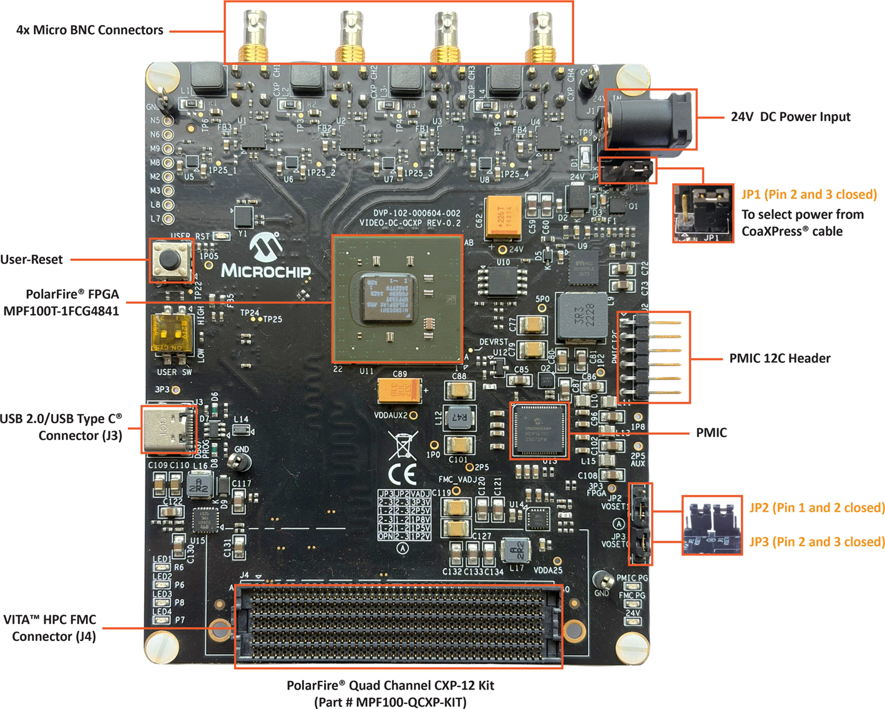

<b>Figure 4: MPF100 QCXP Kit Callout Top View</b>

#### Jumper Settings

The following table lists the jumper settings for the PolarFire Quad Channel CXP-12 kit:

<b>Table 3: Jumper Settings</b>

| Jumper | Default Position | Description |
|--------|------------------|-------------|
| JP1 | Pin 1 and 2 | Selects Power from CoaXPress cable |
| JP2 | Pin 1 and 2 | Default |
| JP3 | Pin 2 and 3 | Default |

#### Hardware Connection Setup

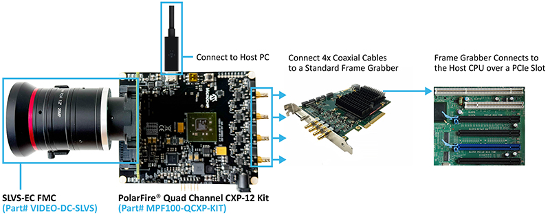

<b>Figure 5: MPF100 QCXP Kit Connection</b>

For setting up the hardware, perform the following steps:

1. Connect the **VIDEO-DC-SLVS** to the **J4 FMC Connector** on the PolarFire Quad Channel CXP-12 kit and adjust the stand to hold the camera properly.

2. Connect the **CoaXPress cables** from CXP-12 Kit to the frame grabber in correct sequence. Make sure that **Power over CoaXPress** is enabled in the frame grabber software.

3. Connect the host PC to the PolarFire Quad Channel CXP-12 kit through **J3** using a **USB type-C cable**.

---

## Running the Demo

To run the demo, perform the following steps:

1. Launch the **Frame Grabber Software** application. Check whether the device is connected to the frame grabber. If not, click **Connect** option to connect frame grabber to the device.

   > **Note:** Some applications automatically connect to the device and display its features. Other frame grabbers will have the **Connect** option to establish a connection between the frame grabber and the device.

2. After connecting the device, use the frame grabber software to stream the SLVS-EC camera output, and then click **Grab/Stream** option.

3. CoaXPress features can be explored in **Camera Features** section in frame grabber software.

4. The gain can be adjusted using **Analog Gain** option. Other camera controls provided to enable or disable **Reverse X**, **Reverse Y** and **Test Pattern**.

## Testing and Validation

### Expected Results

When the demo is running correctly, you should observe:

1. **Device Connection:** The frame grabber software should detect and connect to the CoaXPress device.

2. **Video Streaming:** High-resolution video (5312x4671) should stream at 60 fps from the SLVS-EC camera.

3. **Camera Controls:** GenICam-enabled controls should be accessible:
   - Analog Gain adjustment
   - Reverse X toggle
   - Reverse Y toggle
   - Test Pattern enable/disable

### Frame Grabber Software Screenshots

The following figures show the video capture with various frame grabbers:

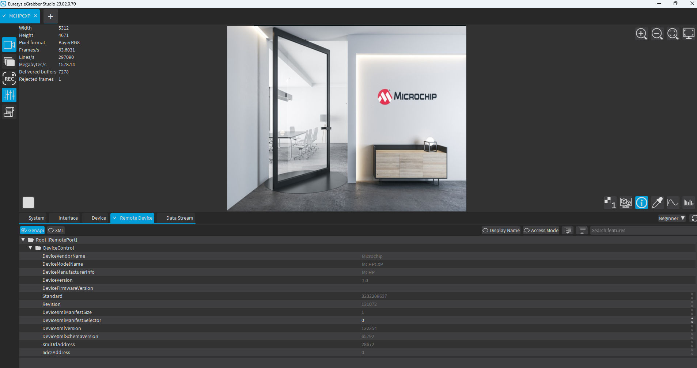

<b>Figure 6a: Euresys Frame Grabber</b>

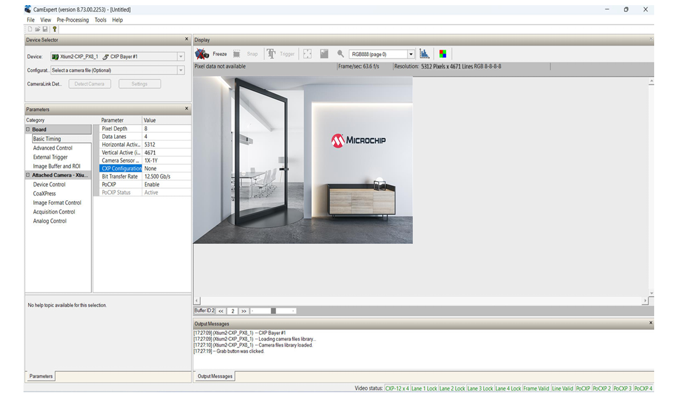

<b>Figure 6b: Teledyne Dalsa Frame Grabber</b>

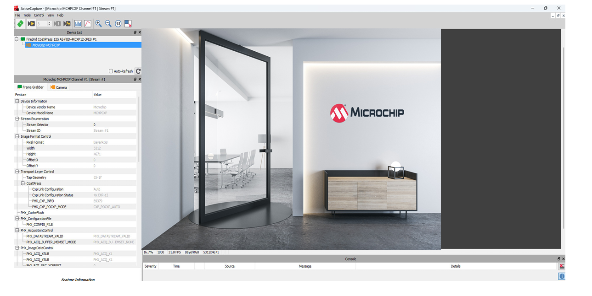

<b>Figure 6c: Active Silicon Frame Grabber</b>

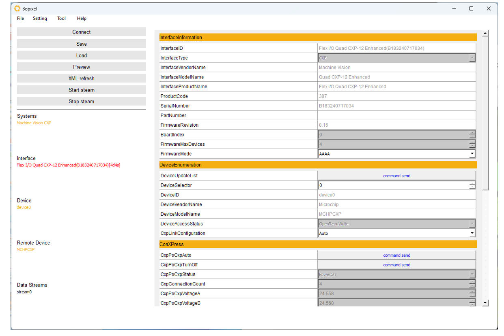

<b>Figure 6d: Bopixel Frame Grabber</b>

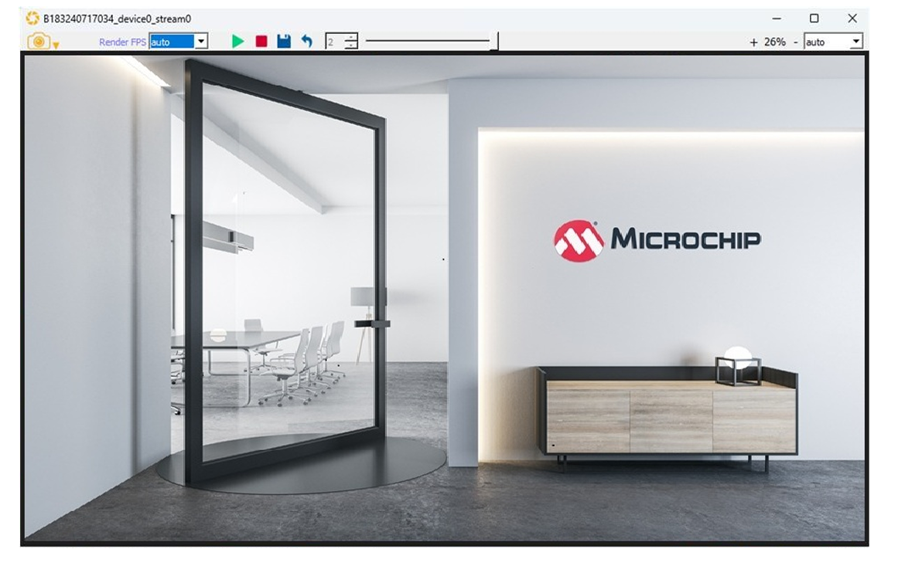

<b>Figure 6e: Device Stream</b>

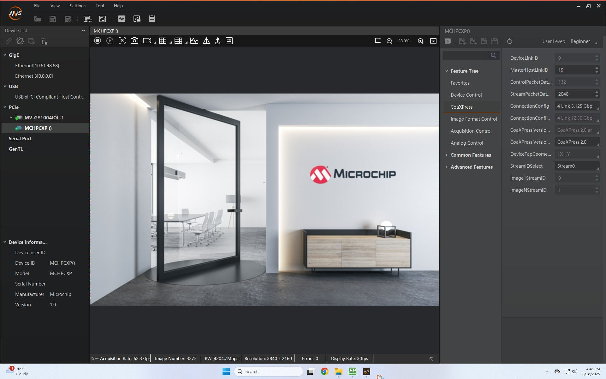

<b>Figure 6f: I-TEK Frame Grabber</b>

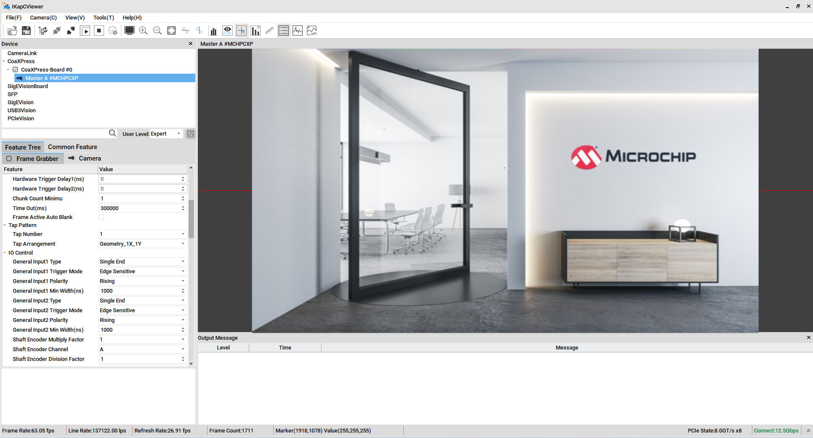

<b>Figure 6g: HIKROBOT Frame Grabber</b>

---

## Functional Description

### Data Flow

The data flow process has the following steps:

1. **Video acquisition:** The SLVS-EC camera outputs video data over eight high-speed lanes, which are received by the FPGA transceivers.

2. **Data extraction:** The SLVS-EC IP core processes the incoming data in Raw8 mode and generates the video data output.

3. **Protocol conversion:** The CoaXPress IP core receives the video stream, formats it into CoaXPress packets and transmits it over four lanes to the frame grabber.

4. **Control and link management:** A dedicated processor subsystem is responsible for:
   - Initializing and configuring the SLVS-EC camera
   - Managing low-speed upconnection packets from the CoaXPress IP core
   - Establishing and maintaining the CoaXPress link with the frame grabber

### Hardware Implementation for IMX_530

The following figure shows the Libero SoC implementation of the top-level SmartDesign:

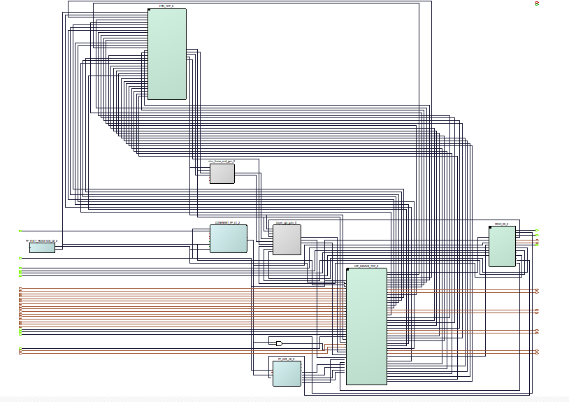

<b>Figure 7: Top Design SmartDesign Schematic (IMX_530)</b>

The SLVS-EC to CoaXPress design includes the following key blocks:

- **CXP_DEVICE_TOP** (CoaXPress, Core PCS, XCVR_0 and XCVR_1)
- **IMX_TOP** (SLVS-EC RX and Core PCS)
- **PROC_SS** (MIV_RV32, CoreGPIO, PF_SRAM_AHBL_AXI and COREI2C)

### Hardware Implementation for IMX_901

The following figure shows the detailed top-level SmartDesign schematic:

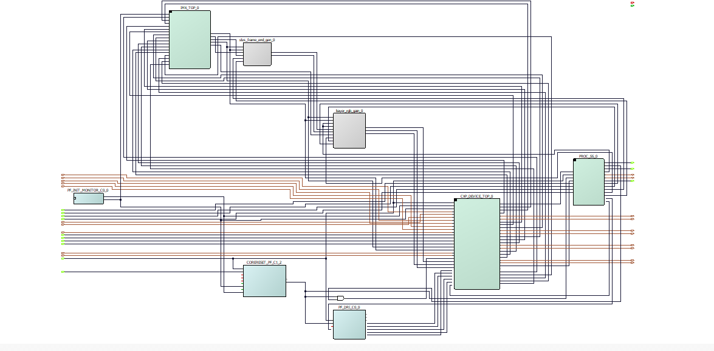

<b>Figure 8: Top Design SmartDesign Schematic (IMX_901)</b>

The SLVS-EC to CoaXPress design includes the following key blocks:

- **CXP_DEVICE_TOP** (CoaXPress, Core PCS and XCVR_0)
- **IMX_TOP** (SLVS-EC RX and Core PCS)
- **PROC_SS** (MIV_RV32, CoreGPIO, PF_SRAM_AHBL_AXI and COREI2C)

### Transceiver Configuration for IMX_530

The design uses two transceiver quads on the FPGA:

#### Transceiver Quad 0

Configured with four independent receive (Rx) and transmit (Tx) lanes:

- **Four Rx lanes:** Connected to the first four SLVS-EC camera output lanes. Rx is configured for **2.376 Gbps** with 40-bit fabric interface width (as per SLVS-EC IP requirement).

- **Four Tx lanes:** Routed to the CoaXPress PHY, enabling high-speed data transmission to the frame grabber. Tx is configured for **12.5 Gbps** (maximum CoaXPress data rate) with 80-bit fabric interface width (as per CoaXPress IP requirement).

<b>Figure 9: Transceiver Quad 0 Configurator (IMX_530)</b>

> **Note:** The XCVR Dynamic Reconfiguration Interface (DRI) is used in this design to dynamically switch the CoaXPress data rates between 1.5 Gbps and 12.5 Gbps. It also configures signal integrity parameters, such as:
> - **Output Voltage Swing:** 500 mV
> - **Pre-Emphasis Setting:** -6 dB
>
> These settings optimize high-speed signal transmission and ensure reliable communication over varying link conditions.

#### Transceiver Quad 1

Configured as a four-lane Rx only mode. These Rx lanes are connected to the remaining four SLVS-EC camera output lanes.

<b>Figure 10: Transceiver Quad 1 Configurator (IMX_530)</b>

### Transceiver Configuration for IMX_901

The design uses one transceiver quad on the FPGA:

#### Transceiver Quad 0

Configured with four independent receive (Rx) and transmit (Tx) lanes:

- **Four Rx lanes:** Connected to the first four SLVS-EC camera output lanes. Rx is configured for **4.752 Gbps** with 40-bit fabric interface width (as per SLVS-EC IP requirement).

- **Four Tx lanes:** Routed to the CoaXPress PHY, enabling high-speed data transmission to the frame grabber. Tx is configured for **12.5 Gbps** (maximum CoaXPress data rate) with 80-bit fabric interface width (as per CoaXPress IP requirement).

<b>Figure 11: Transceiver Quad 0 Configurator (IMX_901)</b>

> **Note:** The XCVR Dynamic Reconfiguration Interface (DRI) is used in this design to dynamically switch the CoaXPress data rates between 1.5 Gbps and 12.5 Gbps. It also configures signal integrity parameters, such as:
> - **Output Voltage Swing:** 500 mV
> - **Pre-Emphasis Setting:** -6 dB
>
> These settings optimize high-speed signal transmission and ensure reliable communication over varying link conditions.

#### CoaXPress IP Configuration

CoaXPress IP configured for four connections and 256-bit data width. 256-bit is selected as the SLVS-EC IP generates 256-bit per clock in 8 Lane configuration and it can be directly connected to the CoaXPress IP.

<b>Figure 12: CoaXPress IP Configurator</b>

<b>Table 4: CoaXPress IP Configuration Parameters</b>

| Parameter | Value |
|-----------|-------|
| Mode | Device |
| Number of Connections | 4 |
| Number of Streams | 1 |
| Stream Data Width | 256 |
| Stream Data FIFO Depth | 2048 |
| Low Speed Data FIFO Depth | 256 |

#### SLVS-EC Configuration for IMX_530

SLVS-EC IP is configured for 8 Lanes which is maximum number of lanes supported by IMX_530 SLVS-EC camera.

<b>Figure 13: SLVS-EC Configurator (IMX_530)</b>

#### SLVS-EC Configuration for IMX_901

SLVS-EC IP is configured for 4 Lanes which is maximum number of lanes supported by IMX_901 SLVS-EC camera.

<b>Figure 14: SLVS-EC Configurator (IMX_901)</b>

#### CorePCS for CoaXPress Configuration

CorePCS is configured for 80-bit Transmitter only mode. It encodes the 64-bit data from CoaXPress IP using 8b10b encoding and provides 80-bit data to XCVR.

<b>Figure 15: CorePCS Configurator for CoaXPress</b>

#### CorePCS for SLVS-EC Configuration

CorePCS is configured for 40-bit Receiver only mode. It decodes the data from XCVR using 8b10b decoding and provides 32-bit data to SLVS-EC IP.

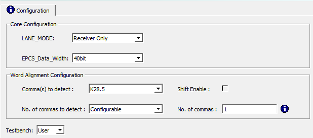

<b>Figure 16: CorePCS Configurator for SLVS-EC</b>

### Clocking Structure for IMX_530

The design uses the following on-board clocks:

- **50 MHz oscillator:** Used to provide a reference clock to CCC_C0 and drives processor subsystem
- **148.5 MHz oscillator:** Used to provide reference clock to TX PLL to generate high-speed clocks to XCVR and to drive XCVR CDR reference clock

The design uses the following generated clocks inside the FPGA:

- **125 MHz and 250 MHz clocks:** Generated using CCC to drive LSUC_CLK125_I and OS_CLK250_I of CoaXPress IP
- **Tx clocks:** CoaXPress IP are connected from XCVR_0 Tx clocks lane wise
- **59.4 MHz clock:** Generated from XCVR lane0 Rx clock to drive pixel clocks of CoaXPress and SLVS EC IPs
- **XCVR Rx clocks:** Connected to SLVS EC IP lane Rx clocks

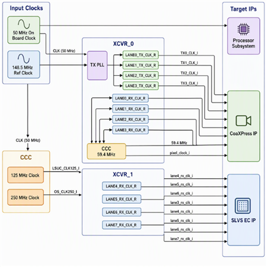

<b>Figure 17: Clocking Structure of IMX_530</b>

### Clocking Structure for IMX_901

The design uses the following on-board clocks:

- **50 MHz oscillator:** Used to provide a reference clock to CCC_C0 and drives processor subsystem
- **148.5 MHz oscillator:** Used to provide reference clock to TX PLL to generate high-speed clocks to XCVR and to drive XCVR CDR reference clock

The design uses the following generated clocks inside the FPGA:

- **125 MHz and 250 MHz clocks:** Generated using CCC to drive LSUC_CLK125_I and OS_CLK250_I of CoaXPress IP
- **Tx clocks:** CoaXPress IP are connected from XCVR_0 Tx clocks lane wise
- **118.8 MHz clock:** Generated from XCVR lane0 Rx clock to drive pixel clocks of CoaXPress and SLVS EC IPs
- **XCVR Rx clocks:** Connected to SLVS EC IP lane Rx clocks

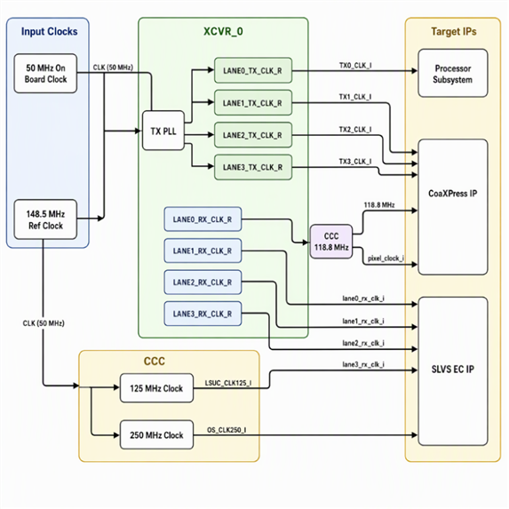

<b>Figure 18: Clocking Structure of IMX_901</b>

### Reset Structure

The design reset structure generates CoaXPress IP Tx resets synchronized to XCVR Tx clocks using CoreReset IP. The SLVS EC IP reset is synchronized to XCVR lane0 Rx clock, this reset also drives the PIX_RSTN_I of CoaXPress IP. The processor subsystem and DRI reset is synchronized to 50 MHz clock.

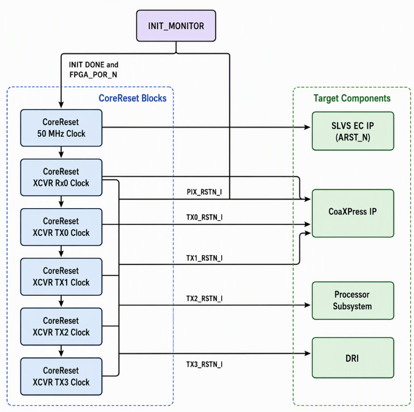

<b>Figure 19: Reset Structure</b>

---

## Resource Utilization for IMX_530

The following table shows the resource utilization of the complete design:

<b>Table 5: Resource Utilization for IMX_530 Sensor</b>

| Elements | Usage in Numbers |
|----------|------------------|
| Fabric 4LUTs | 51989 |
| Fabric DFFs | 37807 |
| Interface LUTs | 7176 |
| Interface DFFs | 7176 |
| Single-Ended I/Os | 15 |
| uSRAMs | 43 |
| LSRAMs | 149 |

## Resource Utilization for IMX_901

The following table shows the resource utilization of the complete design:

<b>Table 6: Resource Utilization for IMX_901 Sensor</b>

| Elements | Usage in Numbers |
|----------|------------------|
| Fabric 4LUTs | 42945 |
| Fabric DFFs | 30291 |
| Interface LUTs | 6132 |
| Interface DFFs | 6132 |
| Single-Ended I/Os | 15 |
| uSRAMs | 43 |
| LSRAMs | 136 |

---

## Appendix A: Running the Tcl Script

Tcl scripts are provided to generate the PolarFire Quad Channel CXP-12 kit reference design.

> **Important:** Separate design folders and programming job files are provided for IMX530 and IMX901 sensors. Ensure that the selected design matches the connected camera module.

To run the Tcl flow, perform the following steps:

1. Launch the Libero® SoC software.
2. Click **Project > Execute Script**.
3. Browse to the `/hw` folder in this repository and select `script.tcl`.
4. Click **Run**.

After successful execution, the Libero project is created inside the `/hw` directory.

The full Tcl folder structure, per-file description, validated Libero version, and IP-core version list are documented in `/hw/readme.md`. For Tcl command syntax, see the Libero SoC Tcl Command Reference Guide. For any queries about running the Tcl script, contact Microchip Technical Support.

### Updating TCL for New Libero Versions and IP Versions

Update the IP Core versions in the `common.tcl` and run the TCL flow in the new Libero version. By default, the given TCL script should run for new Libero and IP releases.

If there are any mismatches in execution, check the following:

1. For Libero related errors, check Libero release notes for changes related to the design components/tools or changes to TCL commands.

2. For IP core related errors, check the IP handbook and release notes for changes in IP configuration parameters, ports and their functionality. If necessary, update the IP configuration parameters, ports and connections in the TCL.

Refer to **Libero SoC TCL Command Reference Guide** for more details on TCL commands. Contact Techsupport if you run into any TCL related queries.

## Appendix B: Programming with FlashPro Express

1. Extract the programming .job file, `mpf100-qcxp-kit-slvs-cxp-IMXxxx.job`, from the packaged archive `mpf100-qcxp-kit-slvs-cxp-IMXxxx-vxxxx.x_Job.zip` which can be downloaded from the release assets of [this](https://github.com/microchip-fpga-solutions/mpf100-qcxp-kit-slvs-cxp/releases) repo.
2. From the Windows Start menu, launch FlashPro Express.
5. To create a new job project, click **New** or navigate to the **Project** menu and select **New Job Project**.
6. In the Create **New Job Project** dialog box, configure the following:
   - Under Import FlashPro Express job file, click **Browse** and select the extracted `mpf100-qcxp-kit-slvs-cxp-IMXxxx.job` file.
   - Under FlashPro Express job project location, click **Browse** and select the desired location for saving the project.
7. Click OK. The required programming file will be loaded and selected for device programming.In the FlashPro Express window, verify that a programmer number is displayed in the Programmer field. If no programmer is detected, check the board connections and click **Refresh/Rescan Programmers**.
8. Click **Run** to start programming the device. After successful programming, the status **Run PASSED** is displayed.
9. Close FlashPro Express, or select **Exit** from the Project tab. The PolarFire device is now successfully programmed.

---

## Appendix C: Troubleshooting Guide

This appendix lists common issues seen while bringing up the SLVS to CoaXPress converter demo and how to resolve them.

<b>Table 7: Troubleshooting Guide</b>

| Issue | Possible Cause | Solution |
|-------|----------------|----------|
| Device not detected by frame grabber | Power over CoaXPress not enabled | Enable PoCXP in frame grabber software settings |
| No video stream | CoaXPress cables not properly connected | Verify all 4 CoaXPress cables are securely connected |
| FlashPro Express doesn't detect programmer | USB cable not connected or drivers not installed | Verify USB connection and reinstall Program and Debug software |
| Low frame rate | Incorrect link speed negotiation | Verify frame grabber supports CXP-12 (12.5 Gbps) |
| Image artifacts | Cable quality issues | Use certified CXP-12 cables |
| Link fails to establish | Incorrect CoaXPress port or lane assignment | Confirm the cable-to-port mapping and ensure that the converter and frame grabber use the same lane configuration |
| Firmware programming fails | Incorrect bitstream, programmer selection, or device configuration | Confirm that the correct firmware image and target device are selected, then power-cycle the converter and retry programming |

### Debug Mode Notes

> **Note:** Remove the `.hex` file from the design when you want to run the SoftConsole in Debug Mode.

---

## Reference Documents

- [PolarFire Quad Channel CXP-12 User Guide](https://ww1.microchip.com/downloads/aemDocuments/documents/FPGA/ProductDocuments/UserGuides/PolarFire_Quad_Channel_CXP-12_User_Guide.pdf)
- [CoaXPress IP User Guide](https://www.microchip.com/en-us/products/fpgas-and-plds/ip-core-tools/coaxpress)
- [PolarFire SLVS-EC Receiver IP User Guide](https://www.microchip.com/en-us/products/fpgas-and-plds/ip-core-tools/slvs-ec-receiver)
- [Libero SoC Tcl Command Reference Guide](https://www.microchip.com/en-us/products/fpgas-and-plds/fpga-and-soc-design-tools/fpga/libero-software-later-versions)

---

## Documentation and Support

- **Microchip FPGA Support:** Contact the Technical Support Center at [www.microchip.com/support](https://www.microchip.com/support). Mention the FPGA Device Part number, select an appropriate case category, and upload design files while creating a technical support case.
- **Customer Service (non-technical product support):** From North America, call 800.262.1060. From the rest of the world, call 650.318.4460. Fax, from anywhere in the world, 650.318.8044.

## Glossary

<b>Table 8: Glossary of Terms</b>

| Term | Definition |
|------|------------|
| AXI4-Lite | A lightweight AMBA AXI subset used for control-plane register access to IP cores |
| CCC | Clock Conditioning Circuit — Microchip FPGA primitive that generates and phase-aligns derived clocks from a reference |
| CDR | Clock Data Recovery — recovers a bit clock from a serial data stream |
| CoaXPress | A high-speed digital interface standard used to transmit image data, control information, and synchronization signals over coaxial cables |
| CXP-12 | A CoaXPress link speed supporting up to 12.5 Gbps per cable connection, subject to the capabilities of the camera, converter, cables, and frame grabber |
| DRI | Dynamic Reconfiguration Interface — allows runtime reconfiguration of transceiver PMA / PCS parameters |
| DPRX | DisplayPort Receiver — receives DisplayPort video, audio, AUX, and link-training data from an upstream DisplayPort source |
| DPTX | DisplayPort Transmitter — transmits DisplayPort video, audio, AUX, and link-training data to a downstream DisplayPort sink |
| FMC | FPGA Mezzanine Card — standardized daughter-card connector used by the SDI Daughter Card on the Video Kit |
| FPGA | Field Programmable Gate Array |
| IP core | Reusable pre-verified logic block instantiated in the design |
| MIV | Mi-V — Microchip's RISC-V soft-processor implementation used as the design's control processor |
| PCS | Physical Coding Sublayer — the transceiver layer responsible for encoding/decoding, alignment, and scrambling |
| PLL | Phase-Locked Loop |
| PMA | Physical Medium Attachment — the analog transceiver layer |
| PROC_SS | Processor Subsystem — the MIV-based control block that manages IP configuration and link management |
| SLVS | Scalable Low-Voltage Signaling — a high-speed differential interface commonly used to transmit image data from an image sensor or camera device |
| SLVS-EC | SLVS Embedded Clock — an SLVS interface variant in which clock information is embedded within the data stream, reducing the need for a separate clock lane |
| TX / RX | Transmit / Receive |
| XCVR | Transceiver — high-speed serial I/O block (PMA + PCS) |

	
	
---
